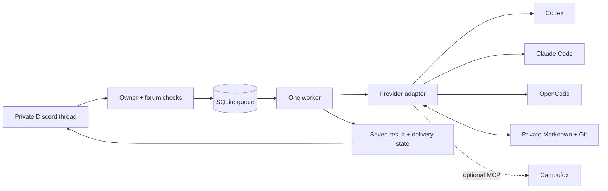

<div align="center">


# szpont-engine

**Run coding agents from private Discord threads.**

Each thread keeps its own CLI session. Accepted tasks stay in SQLite.
Useful context stays in a private Markdown workspace.

[](https://github.com/dalkedev/szpont-engine/actions/workflows/checks.yml)
[](https://github.com/dalkedev/szpont-engine/releases)
[](package.json)
[](LICENSE)

[See it work](#see-it-work) · [Quick start](#quick-start) · [Choose a runner](#choose-a-runner) · [Integrations](docs/integrations.md) · [Documentation](docs/index.md)

</div>

Send a task from your phone, follow up in the same thread, and inspect the result when it finishes.
The machine runs the coding CLI; Discord carries the conversation.

Your phone can go back in your pocket.

## See it work

These captures show the **real Engine and Store running locally with synthetic messages,
transport and runner responses**. They are documentation views of actual offline output,
not screenshots of a connected Discord account or live model results. Text transcripts and
[reproduction instructions](docs/demo.md) are included.

### Follow up without starting over

A second message resumes the saved session. A separate thread gets a separate session.


### Inspect an interruption before continuing

A failed turn remains visible. Queued follow-ups wait; the owner chooses recovery explicitly.
A delivery retry does not rerun the model.


“Queued” is a state, not an optimistic progress report.

Use `!queue` to see which tasks are waiting and why: an earlier task in this thread,
unverified runner readiness, a blocked conversation, or the shared worker. The view
contains task IDs and states from this thread; it does not call a model or expose
messages from other conversations. No invented countdown. Computers have enough timers.

### Keep the runner attached to the conversation

Choose a default for new threads. Existing conversations keep their provider and session,
while unavailable providers do not block eligible work for others.


## What belongs in a thread?

| Task                         | Example message                                                                       |
| ---------------------------- | ------------------------------------------------------------------------------------- |
| Investigate a failure        | `Reproduce the failing parser test, explain the cause, and prepare a focused fix.`    |
| Build in bounded steps       | `!work 30m Add CSV export to the fixture app. Include tests and document the format.` |
| Research before implementing | `Compare these two API designs. Save the trade-offs before changing code.`            |

Choose repository, browser and documentation tools with `npm run integrations`.
Choose Codex, Claude Code, or OpenCode first, then the integration. Use `--runner claude`
or `--runner opencode` to target a runner directly. OpenCode can use Go, Zen or another
configured model provider. The menu prepares your own CLI and explicit MCP configuration; the engine does
not provide model access or accounts. See [integration setup](docs/integrations.md).

## What the engine handles

- **Continuity:** one provider-bound CLI session per Discord thread; private Markdown instructions and notes.
- **Durable intake:** SQLite WAL, deduplicated message IDs, bounded queues and atomic claims.
- **Bounded work:** typed checkpoints, active execution budgets and fair turns between threads.
- **Honest recovery:** interrupted work remains visible; uncertain actions are never replayed automatically.
- **Delivery and maintenance:** result receipts, transcript exports and scoped local Git commits have separate durable state.
- **Deployment checks:** owner/forum authorization, local diagnostics, versioned migrations and verified state snapshots.

The public edition has **one global worker**. Work sessions yield between verified steps;
they do not interrupt a running step. There is no built-in scheduler, publication broker
or message-history catch-up after an outage. Still-image input is available for Codex.

## Choose a runner

| Runner                         | CLI requirement | Where it runs                                                        |
| ------------------------------ | --------------- | -------------------------------------------------------------------- |
| **Codex** — default            | 0.166.0         | Linux host or the published Docker image                             |
| **Claude Code** — experimental | >=2.1.285, <3   | Linux host with restricted mode and mandatory native Bash sandboxing |
| **OpenCode** — experimental    | 1.19.5          | Operator-isolated Linux host; explicit host execution opt-in         |

```sh
SZPONT_RUNNER=codex     # or claude / opencode
```

This selects the default for **new conversations**. Existing threads and recovered jobs retain
their original runner. The engine never switches tools after an authentication or model failure.
Upstream CLI model aliases and provider fallback policies can still apply.

The Docker image packages **Codex only**. Claude Code and OpenCode have different execution
boundaries and private login paths; see [runner setup](docs/runners.md). Their protocol tests
are offline; live account and host-boundary acceptance remain deployment checks.

## How it fits together



Execution, notification delivery and external effects are separate facts.
A successful local turn does not prove a deployment, post or website action succeeded.
[Architecture](docs/architecture.md) covers the state transitions and recovery contract.

To continue a larger task under independent review, use `!goal 30m <goal>` or
`!loop 2h <goal>` in a Codex thread. [Supervised goals](docs/supervised-goals.md)
cover follow-up questions, pause/resume/stop and shared execution budgets.

## Quick start

You need Linux, **Node.js 24.x**, Git, `flock`, your own Discord bot and an authenticated runner.
The default path below uses Codex CLI **0.166.0**.
For containers, start with the [Docker guide](docs/docker.md).

### 1. Install and try the offline demo

```sh
git clone --branch v0.6.1 --depth 1 https://github.com/dalkedev/szpont-engine.git
cd szpont-engine
npm --prefix apps/discord-agent ci --ignore-scripts
npm run build
npm run demo -- session
```

The demo uses synthetic data and needs no Discord token or model account.
Run `npm test` for the offline regression suite.

### 2. Create a private workspace

```sh
npm run init:workspace -- "$HOME/.local/share/szpont/workspace"
```

The initializer creates an independent Git workspace **outside this checkout** and refuses to
overwrite an existing directory. Edit `agent/USER.md` and `agent/POLICY.md` before use.

Create a Discord bot, enable Message Content Intent, and select a private forum in a server
you own. Follow [configuration](docs/configuration.md) for identities and effective permissions.

### 3. Configure and start one instance

```sh
mkdir -p "$HOME/.config/szpont"
cp .env.example "$HOME/.config/szpont/agent.env"
chmod 600 "$HOME/.config/szpont/agent.env"
```

Replace every placeholder and set absolute private paths. The engine does not load `.env`
automatically. Load only your trusted configuration:

```sh
set -a
. "$HOME/.config/szpont/agent.env"
set +a
mkdir -p "$CODEX_HOME" "$SZPONT_STATE_DIR" "$SZPONT_ARTIFACTS_DIR" "$SZPONT_BROWSER_DIR"
chmod 700 "$CODEX_HOME" "$SZPONT_STATE_DIR" "$SZPONT_ARTIFACTS_DIR" "$SZPONT_BROWSER_DIR"
codex login
npm run doctor -- --check-login
flock -n -E 75 "$SZPONT_STATE_DIR/engine.lock" npm --prefix apps/discord-agent start
```

Hold the lock before startup recovery. Send a harmless task in a new private thread to verify
your installation. Offline tests do not establish real Discord permissions, model entitlement
or browser login. See [deployment](docs/deployment.md) for service setup and
[runner setup](docs/runners.md) for Claude Code and OpenCode.

### 4. Choose integrations

With the engine stopped and the same private configuration loaded:

```sh
npm run integrations
# Or configure explicitly:
npm run integrations -- add github --yes
npm run integrations -- login github
npm run integrations -- add openai-docs --yes
npm run integrations -- status
```

The catalog includes GitHub CLI, the optional Camoufox bridge, OpenAI Docs,
Context7 and a custom MCP server. Setup adds maintained usage playbooks to your
private `agent/INTEGRATIONS.md`; it does not download a collection of skills or
import personal credentials. Camoufox needs a separately provisioned Linux host
browser/display. See [integration setup](docs/integrations.md) for Docker builds,
runner-specific configuration, removal and the difference between configuration
and a live acceptance check.

## Discord commands

| Input                  | Effect                                                                                   |
| ---------------------- | ---------------------------------------------------------------------------------------- |
| A normal message       | Queue a task in this thread's saved session                                              |
| `!work 30m <goal>`     | Continue a fixed goal with checkpoints; 1–120 active minutes, at most 32 completed steps |
| `!status`              | Inspect this thread's queue, readiness, work session and delivery state                  |
| `!cancel MESSAGE_ID`   | Cancel queued work or stop this thread's active process                                  |
| `!recover [MESSAGE_ID] [instruction]` | Reconcile the blocking or selected task, then continue its saved session       |
| `!new-session`         | Cancel queued work and clear the session; retain the provider binding and history        |
| `!result [MESSAGE_ID]` | Read a saved response without rerunning work; latest task by default                     |
| `!help`                | Show commands without starting a model                                                   |

Messages received during a full outage may never have entered the queue. Use `!status` to check
what was accepted. Invalid commands show usage rather than becoming model tasks.

A verified work-session pause retains its session and checkpoint. A fresh explicit `!work`
budget can continue it. Crashes, timeouts and malformed outcomes require inspection and manual
recovery. In a blocked thread, a fresh explicit `!work` budget reconciles prior actions
and continues the saved session. See [work sessions](docs/work-sessions.md).

Codex threads also accept up to four still PNG, JPEG or WebP attachments, with a
caption, without text, or alongside an explicit `!work` goal. Images are passed as
native inputs on initial and resumed turns and retained privately with the durable
job. Claude Code and OpenCode image requests are explicitly rejected by these
adapters. See [image input, limits and privacy](docs/image-input.md).

## Public code. Private memory.

```text
szpont-engine/                 # Public source and synthetic templates
~/.config/szpont/agent.env     # Private credentials and deployment IDs
~/.local/share/szpont/
  workspace/                  # Instructions, notes, transcripts and Git history
  state/                      # SQLite queue, private images and provider/session mappings
  codex/                      # Private Codex login and configuration
  browser/                    # Optional browser profile
  artifacts/                  # Task output
```

The engine commits selected Markdown locally; **it does not push memory**. Keep the workspace
remote separate from this public repository. Treat transcripts, credentials, browser profiles
and artifacts as private data. Alternative runners have their own private directories.

Version **0.6.1 retains SQLite schema 4**, introduced in 0.5.0. Take a [verified pre-upgrade snapshot](docs/state-backups.md);
rollback requires compatible state and reconciliation of later actions. Do not point older code
at a migrated database.

## Development

```sh
npm test
# Optional browser package, with Python 3.12 and the locked dependencies:
(cd packages/browser && uv run --locked --offline pytest -q)
```

The tests use synthetic data and fake CLIs. They exercise queueing, migrations, exact session
resume, recovery, provider readiness, process limits and checkpoint validation without
calling a model or posting messages. Container checks additionally exercise the actual Codex
filesystem sandbox. See [demo and capture tooling](docs/demo.md) to reproduce the gallery.

<details>
<summary>Source map</summary>

| Path                                                                                                                                                | Responsibility                                           |
| --------------------------------------------------------------------------------------------------------------------------------------------------- | -------------------------------------------------------- |
| [`config.ts`](apps/discord-agent/src/config.ts)                                                                                                     | Configuration, authorization and child environments      |
| [`engine.ts`](apps/discord-agent/src/engine.ts)                                                                                                     | Execution, maintenance and notification lifecycle        |
| [`store.ts`](apps/discord-agent/src/store.ts)                                                                                                       | Queue, provider bindings, checkpoints and recovery       |
| [`runner.ts`](apps/discord-agent/src/runner.ts)                                                                                                     | Explicit dispatch to the recorded provider               |
| [`codex.ts`](apps/discord-agent/src/codex.ts), [`claude.ts`](apps/discord-agent/src/claude.ts), [`opencode.ts`](apps/discord-agent/src/opencode.ts) | CLI protocols, process bounds and cancellation           |
| [`workspace.ts`](apps/discord-agent/src/workspace.ts)                                                                                               | Prompt context, transcript export and scoped Git commits |
| [`scripts/integrations.mjs`](scripts/integrations.mjs)                                                                                               | Local integration setup, managed configuration and playbooks |
| [`packages/browser/`](packages/browser/)                                                                                                            | Optional Camoufox MCP tools and offline checks           |
| [`examples/workspace/`](examples/workspace/)                                                                                                        | Synthetic workspace templates                            |

</details>

## Trust and limits

There is no exactly-once guarantee for external services. Inspect the actual destination before
recovering an uncertain action. Environment filtering does not isolate processes sharing a Unix
user; browser URL guards do not replace network isolation. Explicit MCP servers remain trusted
processes. Read [security](SECURITY.md) before granting real account access.

The project is MIT-licensed; model access and third-party services are separate.
The [road to 1.0](ROADMAP.md) records the remaining stability gates.

[Documentation](docs/index.md) · [Contributing](CONTRIBUTING.md) · [Releases](docs/releases.md) · [Brand assets](docs/brand.md) · [MIT license](LICENSE)
