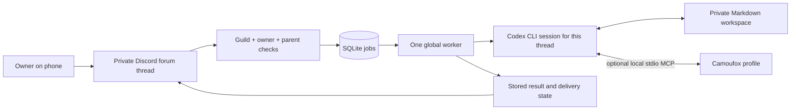

# Architecture

Authorization occurs before any attachment download or enqueue. The adapter verifies the bot identity, configured guild
owner, private forum and reply thread parent. Queue identity is the Discord message ID;
re-delivery of the same ID does not create new work.

A claim is an atomic SQLite update. A global running-job guard serializes all threads and
protects the optional shared browser profile. Startup recovery requires an external singleton
lock: a second engine must not mark a live first engine's work as interrupted.

The worker checks Codex login before claiming work. The subprocess gets the selected private
workspace, explicit writable artifact/browser directories and an environment allowlist. It uses
no shell to execute prompts. The parser bounds event bytes and output, pins resumed session
identity, and requires a completed turn. Cancellation and timeout stop the process group.

## State versus effects

A task transitions from queued to running, then succeeded, failed or interrupted. An uncertain non-success
blocks further work in that conversation until deliberate recovery. A verified workflow budget
pause is interrupted in the job log but deliberately leaves its conversation available. Restarted running work is
interrupted, not queued. Recovery creates a new job with a reference to the original request.
Terminal state and conversation blocking commit in one transaction; a failed write preserves
the running state for reconciliation. Session reset and queued cancellation are also atomic.
Recovery refuses overlap with queued recovery or running work in that thread and refuses to
replay an ancestor already recovered successfully. A failed recovery can itself be recovered.

Notification delivery separately records pending, sending, sent or ambiguous. A process crash
after reserving delivery cannot safely establish whether Discord accepted it. The reservation
becomes ambiguous on startup; the engine does not automatically resend it. `!result` retrieves
the saved answer without rerunning the task.

These are local guarantees. They do not form a transaction with an external website.

`!status` reports the current thread's queue, block reason, session presence, and delivery
state. Global worker occupancy is only a boolean: another thread's identifiers, prompts,
results, and session IDs are not included. `!help` and invalid controls never enqueue work.

`!queue` uses the same runner and predecessor predicates as claiming to explain each
current-thread pending task. Its metadata query never selects prompts, results or
session IDs. Active jobs and recent history use durable acceptance order, including
when the wall clock moves backwards. Inspection does not claim work or query a model.

## Bounded workflows and queue fairness

An explicit `!work` command creates a workflow attached to the original parent job. A completed
process turn must return a strict typed outcome. The engine atomically records its checkpoint,
charged active execution time and workflow state. A valid continuation requeues that same job
at the global tail. Per-thread original ordering prevents a later message overtaking an active
workflow, while other eligible thread heads can run between its verified steps. One step does
not preempt another process; the global worker remains serialized.

Budgets and the 32-step cap bound continuation. Verified exhaustion pauses; crashes, timeouts
and malformed outcomes block. Manual recovery carries the original goal, checkpoint context
and consumed budget through the recovery chain. It cannot refund time or renew an exhausted
budget. An explicit new `!work` in a blocked thread creates a separate budget, retains its
provider-bound session and reconciles prior actions first; it does not refund earlier execution.
When a host dies during a step, its unknown duration conservatively consumes that
workflow's remaining allowance at startup; verified queued checkpoints are unaffected.
See [work sessions](work-sessions.md) for owner controls.

## Durable maintenance

Each transcript-changing transaction also increments its thread's maintenance generation.
The export and local Git commit acknowledge only their captured generation, leaving newer
changes pending. Failures store a sanitized error category and capped retry backoff; they never
change a successful task back into failed work or rerun Codex. Maintenance runs even without
model authentication, with at most two due threads per pass. `!status` distinguishes stale
exports/commits from execution and notification state. A failed progress notice is best effort;
final notification reservations retain their separate ambiguous-delivery behavior.

## State compatibility

`PRAGMA user_version` identifies the SQLite schema. The 0.2 format (version 0) upgrades in one
transaction to version 1, preserving jobs, sessions, results and controls without starting recovery.
Newer unsupported schemas are rejected before journal-mode or schema changes. Startup recovery
still runs only after the external singleton lock is held. Take a [state snapshot](state-backups.md)
before switching versions and restore compatible state before rolling code back.

## Private memory

The engine reads bounded instruction/context files and renders each thread's transcript from
SQLite. Local automatic Git commits include only selected regular Markdown paths under
`agent/`; staged unrelated changes block the automatic commit. Git hooks are disabled for
these operations. No remote credential or push implementation is included.

## Deliberate limits

One worker; one configured server owner; text and bounded still-image intake; no REST history catch-up; no
scheduler; no built-in public posting destination or receipt broker. Extending these requires
explicit authority checks, durable state and regression tests at the new boundary.

## Provider-bound sessions

`runner.ts` dispatches only to the provider stored on a job. New conversation
bindings are acquired transactionally at intake; every queued job snapshots that
identity. Schema 3 adds immutable provider columns while preserving the acceptance
ledger and all existing state. Legacy rows always become Codex. Reset clears a
session without changing its provider. Recovery retains the original provider.

Readiness is tracked per provider. The one global worker claims only eligible jobs,
so an unavailable provider does not block other providers. It never retries an
uncertain turn through another tool or account. Each adapter validates its own
event stream and exact session ID, bounds subprocess output and time, and requires
explicit completion evidence. Protocol tests are offline; live account and host
sandbox acceptance remain separate deployment checks. See [runners](runners.md).

The design trade-offs are recorded in [ADR 0001](decisions/0001-provider-bound-runners.md).

## Private image inputs

Schema 4 adds image bytes, media types and SHA-256 digests tied to jobs. Validated
attachment batches and their job commit atomically. Native Codex image inputs work
on initial and resumed turns; other adapters reject images before fetch. Queued
restart, workflow continuation, manual recovery and state snapshots retain bytes
without refetching signed CDN URLs. Temporary runner files stay under private state
and are removed at turn end or on next singleton-locked startup. See [image input](image-input.md).

## Supervised goal phases

[`!goal` and `!loop`](supervised-goals.md) use the same worker queue and budget as
work sessions. The main Codex worker saves a candidate before a fresh Codex
supervisor reviews evidence. Only an accepted review becomes a checkpoint; its
session never replaces the main conversation session. Schema 5 retains candidates,
review history and owner controls for explicit recovery. Both subprocesses are
charged; fairness yields between reviewed pairs. Pauses preserve candidates,
while failures and uncertain turns block automatic execution.
